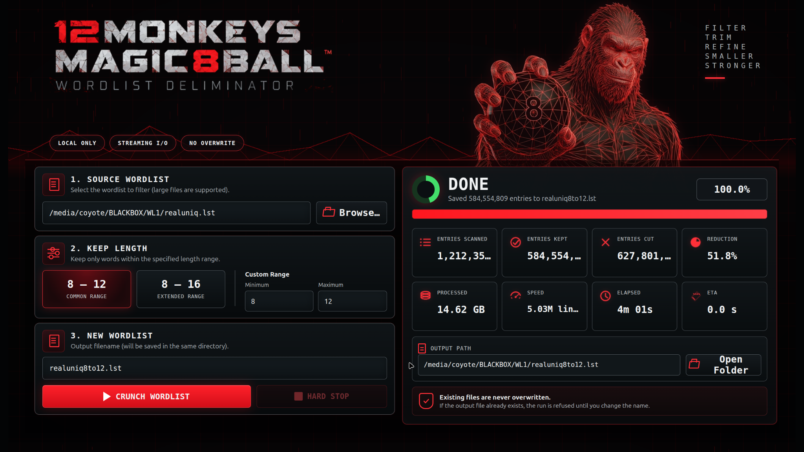

# 12 MONKEYS MAGIC 8-BALL

## WORDLIST DELIMINATOR · VERSION 13.31

**12 MONKEYS MAGIC 8-BALL tames your beast of a 98GB rockyou.text wordlist by limiting candidates to practical WPA/WPA2 passphrase ranges — 8–12, 8–16, or whatever custom range you set — eliminating tons of deadwood so your rule sets work smarter, not harder.**

12 MONKEYS MAGIC 8-BALL is a local Linux wordlist delimiter for very large password lists.

For WPA/WPA2 auditing, 12 MONKEYS MAGIC 8-BALL takes an existing wordlist and creates a smaller working list containing only candidates within the selected passphrase-length range.

Anything shorter or longer is discarded from the new list.

The original wordlist is never modified.

For WPA/WPA2 auditing, where passphrases begin at 8 characters, the included presets are:

- **8–12**
- **8–16**
- **Custom 1–255**

This is useful with very large collections — 27GB, 65GB, 98GB, or larger — where millions or billions of entries may fall outside the WPA/WPA2 passphrase ranges you are concentrating on.

Rather than trying to make Hashcat rules perform the filtering, MAGIC 8-BALL does the filtering beforehand and gives Hashcat a smaller wordlist to work with.

FILTER  · 
TRIM  · 
REFINE  · 
SMALLER  · 
STRONGER  

**[Download 12 MONKEYS MAGIC 8-BALL 13.31 GOLD ZIP](https://github.com/aaronmcnees/12MONKEYSMAGIC8BALL/releases/download/13.31/12MONKEYSMAGIC8BALL-gold.zip)** · [Release notes](https://github.com/aaronmcnees/12MONKEYSMAGIC8BALL/releases/tag/13.31)

## HOW IT WORKS

12 MONKEYS MAGIC 8-BALL reads the source wordlist sequentially instead of loading the entire file into memory.

For each entry:

- shorter than the selected minimum: discard
- inside the selected range: keep
- longer than the selected maximum: discard

The kept entries are written to a new standard text wordlist beside the source file.

The output can be used directly with Hashcat or any other tool that accepts ordinary line-based wordlists.

## FILE SAFETY

12 MONKEYS MAGIC 8-BALL does not modify the source wordlist.

It also does not overwrite an existing output file. If the requested filename already exists, the run is refused.

During processing, output is written to a temporary partial file. If the job is stopped with **HARD STOP** or fails before completion, the partial file is removed.

## LIVE STATUS

While running, the interface displays:

- Entries Scanned
- Entries Kept
- Entries Cut
- Reduction %
- Processed
- Speed
- Elapsed
- ETA
- Overall Progress

## LOCAL ONLY

`RUN.sh` starts the Python backend and opens the interface in your browser.

The backend binds to:

`127.0.0.1`

The wordlist stays on your machine. Nothing is uploaded or sent to a remote service.

No dependencies other than a Linux box, wordlist, and web browser.

## HEXCAT

12 MONKEYS MAGIC 8-BALL complements HEXCAT, but is its own standalone program.

Trim the wordlist first with MAGIC 8-BALL, then use the resulting list for your authorized audit.

That’s it.

---

For authorized password auditing, recovery, and security testing only.

**12 MONKEYS MAGIC8BALL WORDLIST DELIMINATOR · VERSION 13.31 · AETHERCAT / COYOTELABS · 2026**
